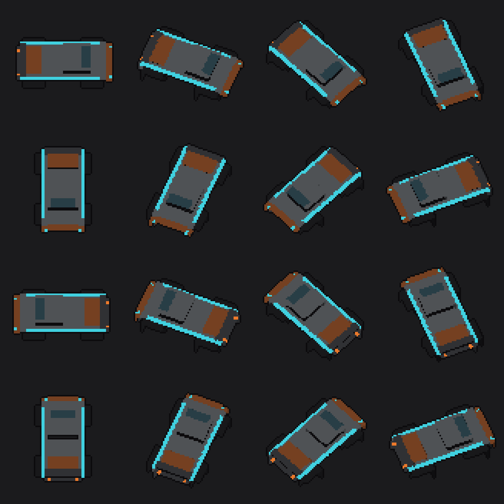
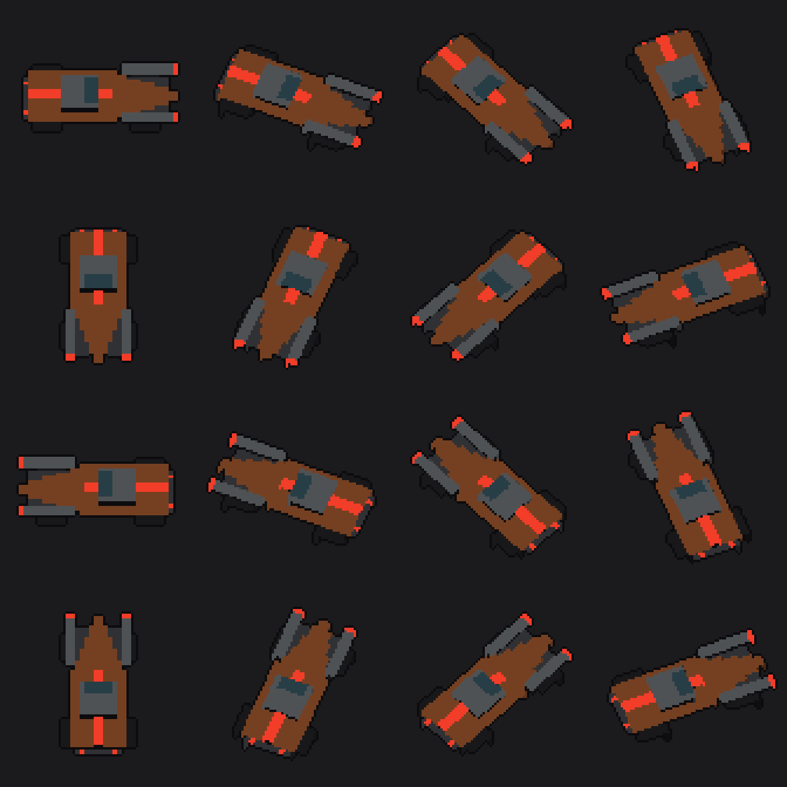
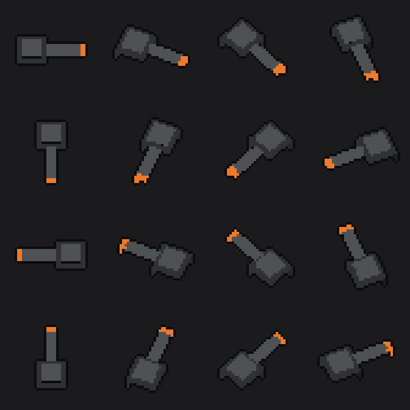

# Art pipeline: pixel-voxel sprites (draft)

Roadmap item "Pixel-voxel art pipeline (voxel models rendered to sprite sheets)".
Draft for review; nothing in the game uses these sprites yet.

## How it works
1. **Models** are voxel grids. Today they are defined in code (`tools/art/models.py`,
   simple `box()` calls); MagicaVoxel `.vox` files also load (`--vox file.vox`).
   Axes: x = forward (nose), y = right, z = up. Hull and turret are separate models,
   because turrets aim on their own.
2. **Palette** is fixed (`tools/art/palette.py`), taken from `scripts/tuning.gd`:
   muted steel/rust/concrete, cyan and orange edge lights, enemy red, elite gold.
   Each colour gets 3 shades (lit top, mid, dark side); light colours are emissive
   and never shade. No other colours are produced.
3. **Renderer** (`tools/art/voxel_render.py`, Python + numpy + Pillow): orthographic,
   camera tilted 30 degrees off straight-down (DESIGN 9: "tight slightly angled
   top-down", rotation-locked), z-buffered, no anti-aliasing, 1 px dark outline.
   1 voxel = 2 px, so a 32x18 hull is 64x36 px, the size `vehicle.gd` already uses.
4. **Sheets**: 16 headings (22.5 degrees each), 4 columns, frame i = heading i x 22.5
   degrees clockwise from +x. A `.json` beside each sheet records the frame size.
   A Godot `.png.import` is written with lossless compression and no mipmaps.
5. **In Godot**: `scripts/directional_sprite.gd` (Sprite2D, nearest filter) picks the
   frame from a heading. The sprite does not rotate; the frame does the turning.

```sh
pip install numpy pillow
python3 tools/art/voxel_render.py   # all models -> art/sprites/
python3 tools/art/preview.py        # 4x previews -> art/previews/
```

## Samples
| | |
|---|---|
| Scrap Frame (player) |  |
| Outrider (enemy) |  |
| Pintle turret |  |

## Open questions
- 16 headings or 32? At 64 px, 16 shows a little stepping when turning slowly.
- Tilt angle (30 degrees now); 0 would allow cheap runtime rotation instead of frames.
- 2 px per voxel, or 1 px per voxel with bigger models?
- Outline: 1 px near-black all round, or coloured/selective?
- Do the cyan edge lights stay player-only, with red for enemies?
- Wreck: render plates as separate voxel chunks for the "voxel plates explode" wreck?
