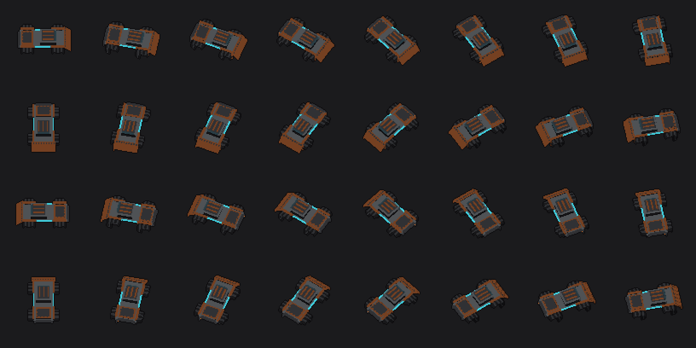
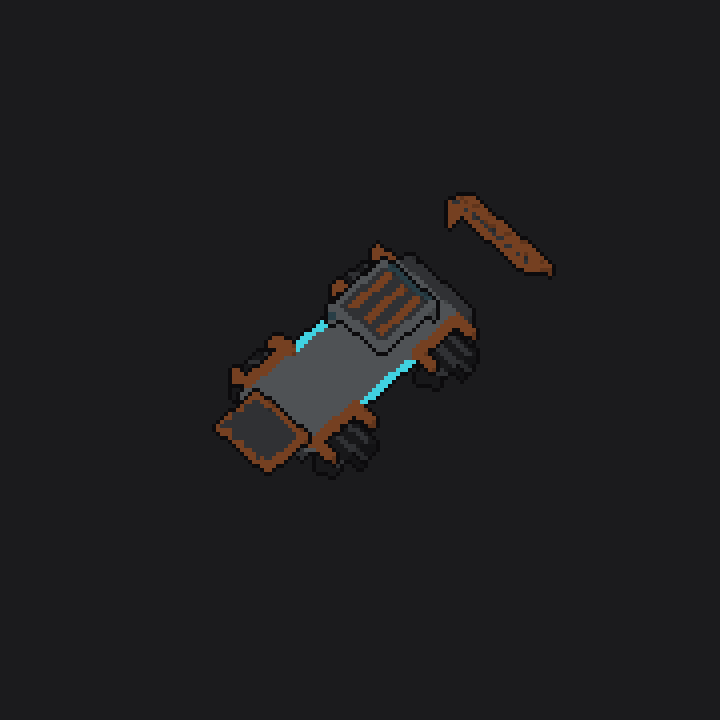
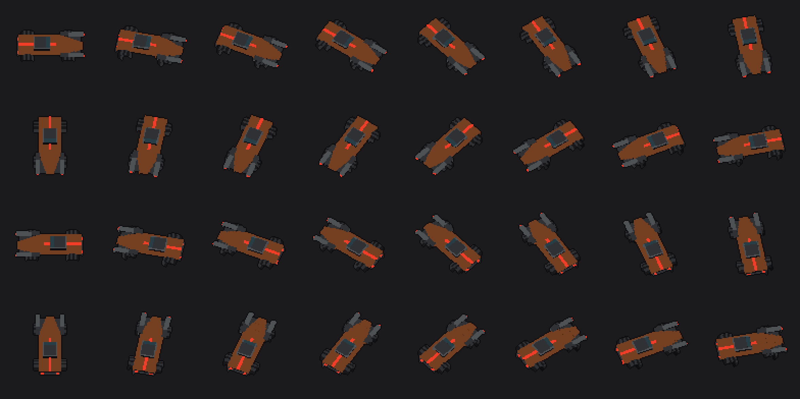
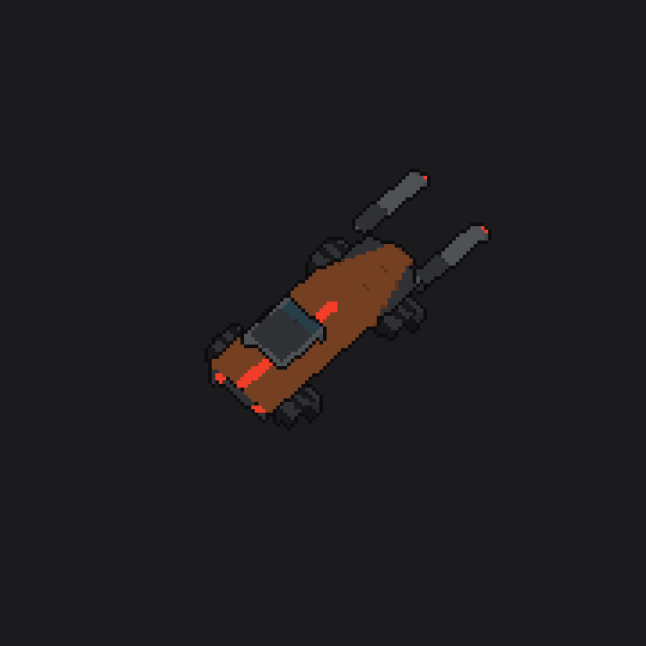
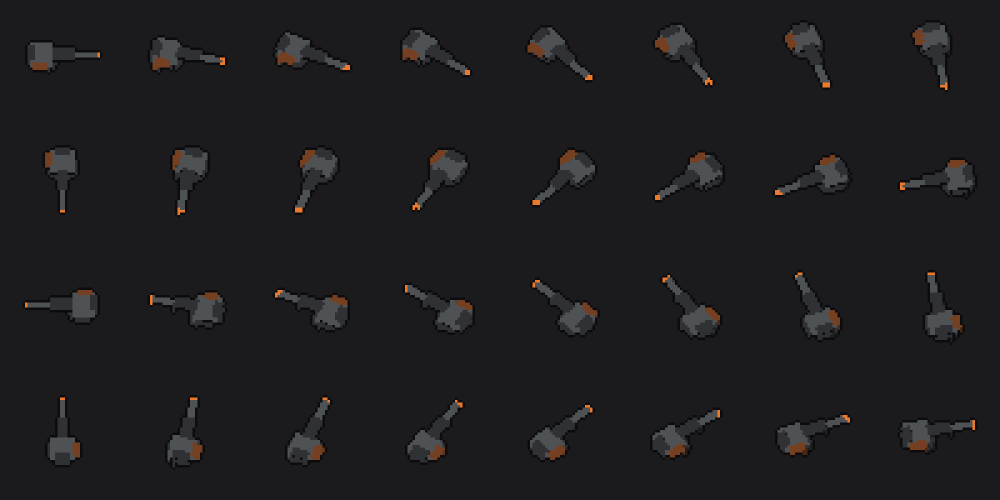

# Art pipeline: pixel-voxel sprites (draft)

Roadmap item "Pixel-voxel art pipeline (voxel models rendered to sprite sheets)".
Draft for review; nothing in the game uses these sprites yet.

## How it works
1. **Models** are voxel grids at **1 voxel = 1 px**, so a hull is about 64x36 voxels,
   the size `vehicle.gd` already uses. They are defined in code (`tools/art/models.py`)
   with `box()`, `wheel()` (round tyre, tread blocks, hub on the outer face) and
   `rivets()`. MagicaVoxel `.vox` files also load (`--vox file.vox`, as one chunk).
   Axes: x = forward (nose), y = right, z = up. Hull and turret are separate models,
   because turrets aim on their own.
2. **Chunks**: each model is a set of named parts (Scrap Frame: wheels, chassis, cab,
   front_plate, rear_plates; Outrider: wheels, chassis, cockpit, guns; turret: mount,
   barrel), all on the same grid. Each chunk gets its own sheet, using the same frame
   size and centre as the composite, for the wreck ("voxel plates explode").
3. **Palette** is fixed (`tools/art/palette.py`): the `scripts/tuning.gd` colours, with
   3 shades each (lit top, mid, dark side). Light colours (cyan, orange, enemy red,
   elite gold) give off their own light and never shade.
4. **Renderer** (`tools/art/voxel_render.py`, Python + numpy + Pillow): straight-on
   (orthographic) view, camera tilted 30 degrees off straight-down, z-buffered, no
   anti-aliasing, 1 px near-black outline all round.
5. **Sheets**: **32 headings** (11.25 degrees each), 8 columns x 4 rows; frame i =
   heading i x 11.25 degrees clockwise from +x. Frames are square (Scrap Frame 90 px,
   Outrider 92, turret 44). The frame centre is the footprint centre at ground level.
6. **Metadata** `<model>.json`: `sheet`, `frame_w/h`, `columns`, `directions`,
   `px_per_voxel`, `tilt_deg`, and `chunks.<name>` = `{sheet, voxels, offsets}`.
   `offsets[i]` is the chunk's pixel centroid relative to the frame centre at heading
   i: spawn the piece there and fling it outward along it.
7. **Godot**: `.png.import` uses lossless compression with no mipmaps.
   `scripts/directional_sprite.gd` (Sprite2D, nearest filter, never rotated) has
   `load_meta(json)`, `heading` -> `frame`, `chunk_texture(name)` and
   `chunk_offset(name)`. `tests/art_sheet_test.gd` checks sheet sizes and frame
   selection across all 32 headings, including jitter and wrap-around.

```sh
pip install numpy pillow
python3 tools/art/voxel_render.py   # all models -> art/sprites/
python3 tools/art/preview.py        # previews -> art/previews/ (Godot ignores this folder)
godot --headless --path . --import
godot --headless --path . -s res://tests/art_sheet_test.gd
```

## Samples
| | |
|---|---|
| Scrap Frame, 32 headings (3x) |  |
| Scrap Frame chunks pulled apart (4x) |  |
| Outrider, 32 headings (3x) |  |
| Outrider chunks (4x) |  |
| Pintle turret (3x) |  |

## In game
- **Anchor:** each frame's centre is the footprint centre at ground level, which is the rig's collision centre. Every sheet's JSON has a `ground_centre` point that projects to (0, 0) at all headings.
- **Points:** `points.<name>` gives 32 pixel offsets, one per heading.
  - Hulls: `turret_mount` (one weapon), or `mount_a` and `mount_b` (two weapons, Bulwark Frame).
  - Turret: `pivot` and `muzzle`.
- **Hulls:** `vehicle.gd` draws the Scrap Frame and Bulwark Frame from their sheets, and `enemy_rig.gd` draws the plain Outrider. Every other rig keeps the code-drawn look.
- **Turrets:** each turret sheet picks its frame from its own aim and sits on its mount. Bullets still start from the unchanged gameplay pivot.
- **Wreck:** every chunk except the chassis is flung outward from its offset for this heading. Each piece spins and fades over 1.4 s. The hull switches to the darkened chassis sheet, and fire, dust and the crew-haul flow are unchanged. A revive restores the full sheet.
- **Part layers (voxel):** chassis models have a core (chassis, cab, rear plates, skirts) plus part layers, each built for that chassis's size:
  - `drive:` street wheels, off-road tires, sport wheels, half-track
  - `armor:` scrap, riot, spiked ram, composite, Outrider light plating, cowcatcher ram
  - extras: `nose_guns`, `nose_guns_hot`, `patch_kit`, `mine_rack`, `sensor_dish`, `roll_cage` (the cage is fitted to that chassis's cab)
  - A layer is rendered together with the core, using per-pixel owner ids, and keeps only the pixels the layer actually shows. So it stacks on the core sheet with the core's occlusion baked in, with the same frame and the same ground anchor.
  - `art_layers()` in `vehicle.gd` picks the layers from the equipped parts. A part without its own sheet uses the stock sheet for its slot.
- **Wreck pieces:** layers split into pieces, one per wheel or track, each with its own per-heading offsets. A wreck flings the core chunks (all but the chassis) plus every piece of the fitted layers. The hull switches to `<model>__chassis_burnt.png`, a soot palette where the lights go darker than the hull.
- **Sheets per chassis:** `<model>__core.png` (the hull sprite), `<model>.png` (composite with the stock parts, for previews), `__<chunk>.png`, `__L_<layer>.png` and `__L_<layer>__<piece>.png`.
- **Old part marks (replaced by the voxel layers above):** `art_marks()` reads the equipped parts and draws small overlays on the deck for:
  - drive: half-track, off-road tires, sport wheels
  - front armor: anything other than Scrap Plating
  - nose guns, white-hot while Overcharge or Deadeye is active
  - patch kit, mine rack, sensor dish, roll cage
- **Overcharge on turrets:** turret art shows a white-hot glow at its `muzzle` point.
- **Captures:** `tools/art/capture_mission.gd` and `tools/art/capture_showcase.gd` take screenshots under Xvfb.

## Decided (Cameron, 2026-11-03)
30 degree tilt; 32 headings; tuning.gd colours with 3 shades; 1 px per voxel with
finer models at ~64x36 on screen; near-black outline all round; separate chunk sheets
for the wreck.

## Open
- Layers stack in a fixed order (drive, armor, extras), so where two layers overlap the later one always wins.
- No art yet for the Courier Frame, the other enemy rigs, or weapons other than the pintle.
- Chunks render on their own, so a chunk sheet shows faces that the composite hides
  (correct for flying debris).
- Hull and turret pivots: the turret mount point per heading isn't in the metadata yet.

## Art lookup by id (content models)
Art is found **by id**: something with id `X` wears `res://art/sprites/X.json` (plus its sheets) if that file exists, otherwise it keeps the code-drawn look. Nothing else needs registering.

| Kind | Where the id comes from | Placement |
|---|---|---|
| Chassis | `look.chassis` (parts id) | hull sheet + part layers (drive, armor, extras) |
| Turret weapon | the weapon's part id (`gun_stats[i].id`; "" = `pintle_turret`) | ring `pivot` on the hull's `turret_mount` / `mount_a` / `mount_b`, frame from its aim |
| Fixed weapon | the weapon's part id | rear `pivot` on the hull's `nose_mount`, frame from the hull heading; replaces the stock `nose_guns` layer |
| Utility | `shock_pulse` in `look.utility` | `shock_emitter` hull layer |
| Enemy rig | `art_id()` in `enemy_rig.gd` ("outrider"); a subclass overrides it | hull sheet; a Hunt elite (`make_elite`) adds the `elite_trim` layer |

Sheets that already ship for ids from the unmerged content branch (Proposal 01):
- **Rigs:**
  - `torcher`: rear `fuel_tank` chunk, `weak_spot` and `muzzle` points
  - `sludger`: `tank` chunk, `turret_mount` for its lobber
- **Weapons:**
  - fixed: `rivet_gun`, `flame_sprayer`
  - turrets: `acid_lobber`, `arc_projector`

These pick up art automatically:
- A weapon picks up its art as soon as its part id exists in `parts.gd`.
- A rig picks up its art once its script returns its id from `art_id()`, e.g. `func art_id() -> String: return "torcher"`.

Every enemy hull has an `elite_trim` layer (gold spine stripe and nose chevron).

**Enemy colours:** enemy red `#F23D29`, acid `#99F240`, goop `#E0A458` and elite gold `#FFC740`. `tests/art_content_test.gd` fails if an enemy sheet contains cyan `#40D1E0`, push orange `#ED7A2B`, shield `#8CBFFF` or truck `#73D980`.

**Export:** `export_presets.cfg` includes `art/sprites/*.json`, so the APK ships the metadata.
